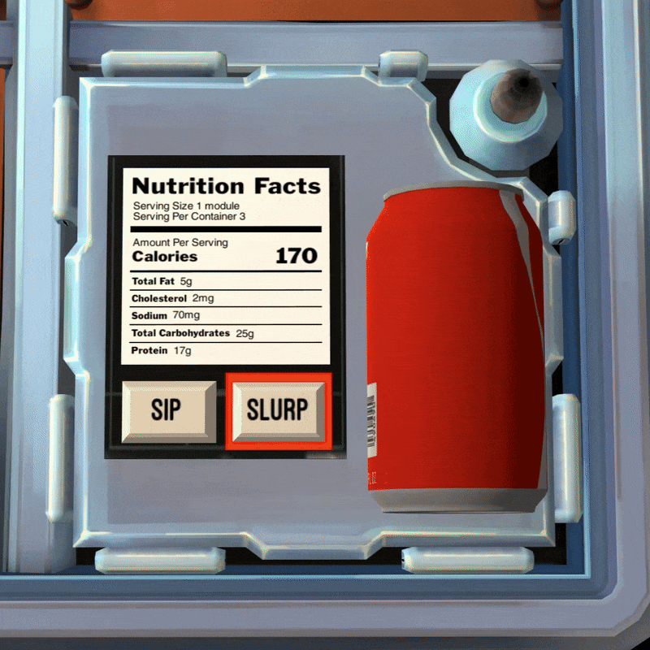

## About Soda

This is a mod created for the game [Keep Talking and Nobody Explodes](https://store.steampowered.com/app/341800/Keep_Talking_and_Nobody_Explodes/) (KTaNE).

Rather than components that you'd expect on a bomb (wires, passwords, buttons, etc.), this module tempts you with a delicous generic-brand cola.
It is to be taken seriously, however. If you choose the wrong attack plan for consuming this beverage, explosive consequences may ensue.

## Showcase/Tutorial

AxoDeaU kindly created a tutorial video that you can watch [here](https://www.youtube.com/watch?v=jL0RFTukYEg&t=2s)

## Installation

1. Subscribe to [Soda](https://steamcommunity.com/sharedfiles/filedetails/?id=3125525686) on the Steam Workshop
2. Wait for the download to finish and then launch KTaNE 
   - If there are issues with the module, unsubscribe and resubscribe to the item on the Steam Workshop
   - You may have to restart your game for the module to appear in your mods list 

## Helpers/Contributors

This is the first mod I've created for this game and it has been a very enjoyable process. I'd like to thank everyone that helped me in the creation of this module.
This includes, but is not limited to:

- [Royal_Flu$h](https://youtube.com/@persephoneschair8483?si=XaT5k0Zpe4ZTzwOj) for his KTaNE modding tutorial series
- [Luminoscity](https://github.com/Luminoscity) for cleaning up the scuffed manual page I provided
- [Blananas2](https://github.com/Blananas2) for creating the module icon for the manual page
- [Kilo](https://github.com/KiloBites) for adding TwitchPlays support to this module
- [AxoDeaU](https://youtube.com/@axodeau?si=yvhWr4DV2INJ4noY) for creating a tutorial video for the module
- KTaNE Discord users who found bugs in my implementation

## Links

- [Manual page](https://ktane.timwi.de/HTML/Soda.html)
- [KTaNE ModKit](https://github.com/keeptalkinggame/ktanemodkit)